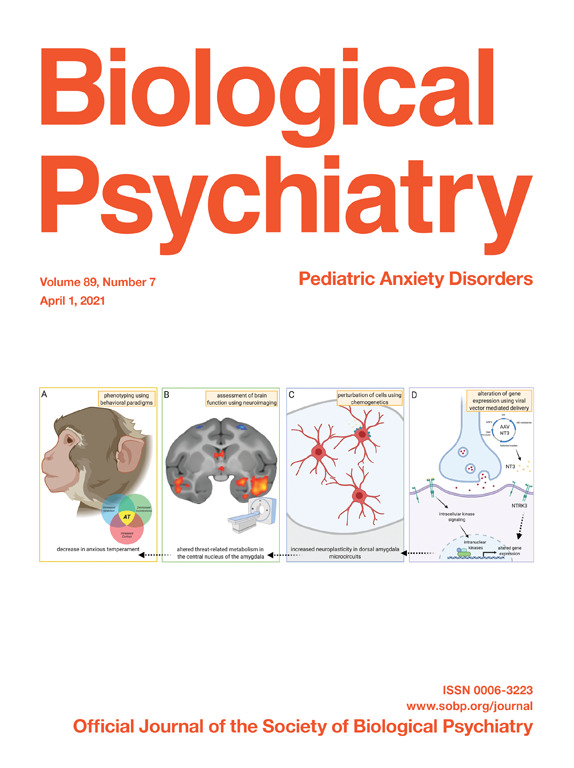

Work from Fox was shown on the cover of the *Biological Psychiatry* special issue on Pediatric Anxiety Disorders.

The cover image is from a review by Kenwood & Kalin, that heavily draws from work done by Fox and colleagues. Much of this which began during Fox’s time in the Kalin lab and has continued since he joined the faculty at UC Davis. In their review, Kenwood & Kalin highlight the translational potential of the nonhuman primate model of early-life behavioral inhibition for understanding pediatric anxiety disorders.

TL;DR; It’s fun to see your ideas featured on the cover of a journal, especially if you didn’t have to write the paper. :-)

If you are curious, *a lot* of the work they discuss is available here:

- [Kalin et al.](https://asfox.github.io/publications/BrainRegionsAssociatedWithTheExpressionAndContextualRegulationOfAnxietyInPrimates_2005.pdf), *Biological Psychiatry*, 2005
- [Fox et al.](https://asfox.github.io/publications/traitLikeBrainActivityDuringAdolescencePredictsAnxiousTemperamentInPrimates_FoxAS_2008.pdf), *PLoS One*, 2008
- [Christian et al.](https://asfox.github.io/publications/SerotoninTransporterBindingAndGenotypeInTheNonhumanPrimateUsingC11DASBPET_2009_Christian.pdf), *Neuroimage*, 2009
- [Oler\*, Fox\*, et al.](https://asfox.github.io/publications/OlerFoxEtAl2010.pdf), *Nature*, 2010
- [Fox et al.](https://asfox.github.io/publications/OrbitofrontalCortexLesionsAlterAnxietyRelatedActivityInThePrimateBedNucleusOfStriaTerminalis_Fox.pdf), *Journal of Neuroscience*, 2010
- [Jahn et al.](https://asfox.github.io/publications/SgpPFCPredictsIndividualDifferencesInHPAActivityAcrossDifferentContexts_Jahn.pdf), *Biological Psychiatry*, 2010
- [Fox et al.](https://asfox.github.io/publications/PNAS-2012-Fox-1206723109.pdf), *PNAS*, 2012
- [Shackman\*, Fox\*, et al.](https://asfox.github.io/publications/NeuralMechanismsUnderlyingHeterogeneityInThePresentationOfAnxiousTemperamentShackmanFox_2013.pdf), *PNAS*, 2013
- [Fox & Kalin](https://asfox.github.io/publications/FoxKalin_ajp_2014.pdf), *American Journal of Psychiatry*, 2014
- [Fox et al.](https://asfox.github.io/publications/Fox_PNAS_2015_IntergenerationalNeuralMediators_withSupp.pdf), *PNAS*, 2015
- [Fox et al.](https://asfox.github.io/publications/Fox_2015_extendingTheAmygdala.pdf), *Trends in Neuroscience*, 2015
- [Kalin et al.](https://asfox.github.io/publications/kalin_et_al_2016_BiologicalPsychiatry.pdf), *Biological Psychiatry*, 2016
- [Fox & Shackman](https://asfox.github.io/publications/Fox_Shackman_2017_NeurosciLetters.pdf), *Neuroscience Letters*, 2019
- [Fox\*, Souaiaia\*, et al.](https://asfox.github.io/publications/FoxEtAl_2019_BiologicalPschiatry.pdf), *Biological Psychiatry*, 2019
- [Kovner et al.](https://asfox.github.io/publications/KovnerEtAl_Neuroscience_2019.pdf), *Neuroscience*, 2019
- [Tromp et al.](https://asfox.github.io/publications/TrompEtAl_2019_BiologicalPsychiatry.pdf), *Biological Psychiatry*, 2019
- [Kovner et al.](https://asfox.github.io/publications/KovnerEtAl_BiologicalPsychiatry_2020.pdf), *Biological Psychiatry*, 2020

Plus, a lot more work like this on our [publications](/publications/) page.
