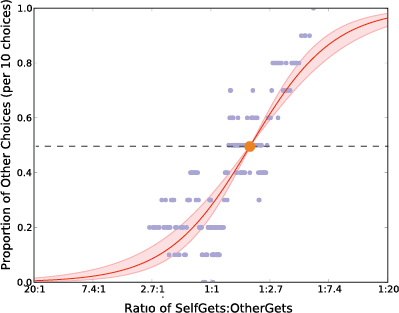
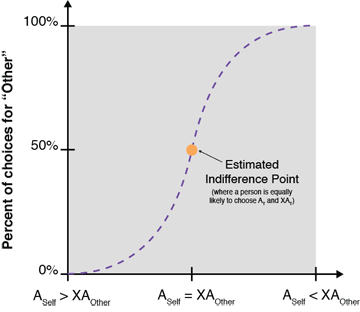
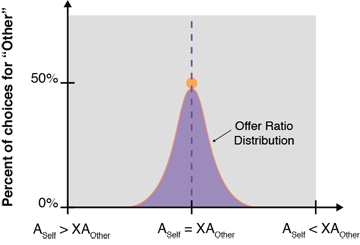

One of the most important questions that faces our world is, How do we get people to be nice? This is a somewhat stupid question, but sits at the center of so many of the world's problems. Joining the ranks of people bringing science to this problem, my friend Nate and I created a game.

Our Self-Other Game is essentially a revealed preference dictator game. You can play the [Self-Other Game here.](http://webtasks.keck.waisman.wisc.edu/self_other_demo/) At the end of the game, you can see a plot like this.

This technique allows us to quantify each participant's Indifference Point which represents how much a dollar to a stranger is worth to you, in dollars. We compute this value by fitting a logistic regression to each subject's choices and determining the 50% ratio, where the person is indifferent between a dollar for themselves or X dollars for a stranger.

Actually, our game is a little more complicated than that. Check it out below if you wish. I'd love to get feedback.

## Self-Other Game Algorithm

### Step 1: Participant makes a choice.

> Subjects make forced monetary decisions between money for themselves (\$0-\$10) and money for a stranger (\$0-\$10). To precisely quantify the amount of money an individual was willing to sacrifice to give a dollar to a stranger (i.e. their indifference point or “IP”), we adaptively altered the ratio of the two others.

### Step 2: Estimate an indifference point (IP).

> $$
> \begin{aligned} C_{1:t} = \frac{1}{1+e^{ \alpha+\beta [ln(OR_{1:t})]}} \end{aligned}
> $$
>
> C\[1:t\] is a vector of indicator variables {0,1} for each choice from the first trial through the current trial (t), where ones indicate choices for self. OR is the other ratio for trial t. Using this model, we estimate α & β. α is the parameter estimate to a constant. β is the parameter estimate of interest, and represents the weight applied to the other ratio. Using these parameters, we estimate indifference points from ln(-3) to ln(3).
>
> $$
> IP = \frac{-\alpha}{\beta}
> $$

### Step 3: Pick a ratio based on a normal distribution centered around the participant’s indifference point (IP).

> $$
> \begin{aligned} OR_{t+1} &\sim \mathcal{N}(\mu=\hat{IP},\sigma^2=.25) \\ &= P(OR_{t+1}) \\ &=\frac{1}{.25\sqrt{2\pi}} e^{\left(\frac{-1}{2}\right)\left(\frac{x-\hat{IP}}{.25}\right)} \end{aligned}
> $$
>
> In order to discourage gaming of the system, we also draw from a normal distribution centered around 0 \~50% of the time.
>
> $$
> \begin{aligned} OR_{t+1} &\sim \mathcal{N}(\mu=0,\sigma^2=.25) \\ &= P(OR_{t+1}) \\ &=\frac{1}{.25\sqrt{2\pi}} e^{\left(\frac{-1}{2}\right)\left(\frac{x}{.25}\right)} \end{aligned}
> $$

### Step 4: Randomly pick amounts to other based on this ratio to present to the participant.

> $$
> A_{Self,t+1} \sim \mathcal{U} \left( \frac{.01}{\min(1,OR_t+1)}, \frac{.01}{\max(1,OR_t+1)} \right)
> $$
>
> $$
> A_{Other,t+1} = A_{Self,t+1} \times OR_{t+1}
> $$

### Wash, rinse, repeat.

> Go back to Step 1.

## Wanna know more?

You can see what it's like to be a participant in of our experiments, by playing for [yourself online.](http://webtasks.keck.waisman.wisc.edu/self_other_demo/)

You can check out some data we collected by looking at the [poster I presented at CNS.](https://asfox.github.io/publications/foxAS_CNS_2011_reprint.pdf)

Let me know if you have any questions or comments. :-D
