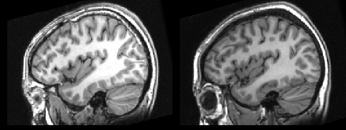

Most neuroimaging analyses depend on doing some statistics in a standard space where each subject's brain is in the same spot. For example, you can use fslview from the FMRIB's [FSL toolbox](http://fsl.fmrib.ox.ac.uk/fsl/fslwiki/) to compare different subjects' brains by watching them wiggle.

In principle, it should be relatively easy to tell if your co-registration worked. Unfortunately, as you increase the parameters of a non-linear warp, maximally-accurate alignment becomes increasingly elusive. Optimizing registration parameters, preventing over-warping, and making sure all your subjects have quality data in your regions of interest becomes increasingly tedious, as your registration gets more complicated.

The problem is made worse, when you are forced to look at two subjects side-by-side, as you can be fooled into thinking they are in great alignment. As seen here.



To prevent this I try to look at changes across subjects using fslview or by creating a movie, as seen here.

*(The original video for this tutorial is no longer available.)*

You can do this quite easily with your own data. First, merge all the subject\*nii standard-space images into the same file. Once they are in the same file, with subject concatenated in time, you can use fslview to view them as a flipbook style movie.

```bash
fslmerge -t output.nii subject*.nii
fslview output.nii
```

Once you have the merged images, you can click the button that looks like IMG to watch them wiggle.

I have used this technique to look at T1-weighted MRIs, SPMs, BOLD fMRI scans, diffusion weighted MRI images (i.e. DTI, DWI, FA, MD, etc.), as well as numerous types of positron emission tomography scans (PET), in both humans and monkeys. It has proven very illuminating. I would love to engage in more discussion about when the [warp is good enough.](/resources/why-registration-matters-in-big-n-brain-imaging-studies/) :-D

P.S. If you want to know how I created the flipbook movie above, [click here](/resources/python-flipbook-movies/).
