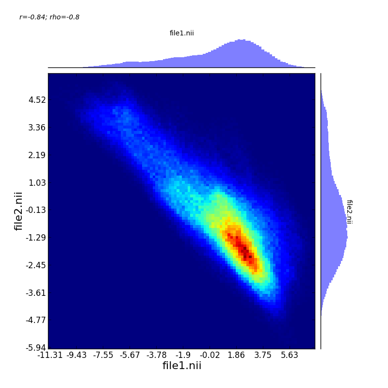

In neuroimaging, we often consider how a single variable affects every region of the brain, but rarely consider how these maps relate to each other. I wrote a little python code that lets me look at the correlation between two brain volumes.

For example, here is a picture that describes the relationship between two statistical images that are negatively correlated.



This image was created with the command:

```bash
python plotImage2Image_2dHist.py -x file1.nii -y file2.nii -fx 0 -fy 0
```

I have used this code in a number of ways, and would be excited to hear how you think it might be useful. If you want to download the code, you can skip to the [bottom of the page](#all-the-code). It may require a bit of python knowledge, but feel free to let me know if you have any problems.

Otherwise, here a bit of a tutorial showing how the code works. :-D

## Walkthrough the code.

First off this code will require other packages, including [Nibabel](http://nipy.sourceforge.net/nibabel/), [Numpy](http://www.numpy.org/), and [matplotlib](http://matplotlib.org/).

```python
import nibabel as nib
import numpy as np
import matplotlib.pyplot as plt
```

Some parts will also require the NullFormatter from [matplotlib](http://matplotlib.org/) and the Spearman's correlation from [scipy](http://www.scipy.org/).

```python
from scipy.stats import spearmanr
from matplotlib.ticker import NullFormatter
```

First you will need to load two files using [Nibabel](http://nipy.sourceforge.net/nibabel/).

```python
img = nib.load('file.nii')
img2 = nib.load('file2.nii')
```

Once you have images loaded, you will need to access their data.

```python
# get image data.
img_data = img.get_data()
img2_data = img2.get_data()
```

Because the correlation that we are looking at doesn't care where these voxels are in space, we can get rid of that information here and convert our volume images to 1D vectors. This makes the rest of the code a little simpler.

```python
x_data = img_data.reshape((img_data.shape[0]*img_data.shape[1]*img_data.shape[2],-1))
y_data = img2_data.reshape((img2_data.shape[0]*img2_data.shape[1]*img2_data.shape[2],-1))
x = x_data
y = y_data
```

Now we can start the plotting process with a rectangular Figure. This plot will have three parts, one 2D histogram and a histogram for each axis.

```python
mainFig = plt.figure(1, figsize=(8,8), facecolor='white')

# define some gridding.
axHist2d = plt.subplot2grid( (9,9), (1,0), colspan=8, rowspan=8 )
axHistx  = plt.subplot2grid( (9,9), (0,0), colspan=8 )
axHisty  = plt.subplot2grid( (9,9), (1,8), rowspan=8 )
```

Here we create the 2D Histogram, which represents the scatter plot. This histogram will be have high values in bins where many points overlap, so that we can quickly plot a very dense dataset.

```python
H, xedges, yedges = np.histogram2d( x, y, bins=(100,100) )
axHist2d.imshow(H.T, interpolation='nearest', aspect='auto' )
```

Now we can make histograms for x and y separately. These histograms will use the same bins as the 2D histogram, and fit on each axis.

```python
axHistx.hist(x, bins=xedges, facecolor='blue', alpha=0.5, edgecolor='None' )
axHisty.hist(y, bins=yedges, facecolor='blue', alpha=0.5, orientation='horizontal', edgecolor='None')
```

Draw the plot!

```python
plt.show()
```

This is basically it. The rest is just a bunch of extra stuff that I did to make it pretty. You can learn more about each of these below.

## Add a Correlation

I wanted my plot to give me a statistic on the relation between the two data-sets. Here is how you add the $r$ and $\rho$ values to the top of the image, like so.

```python
mainFig.text(0.05,.95,'r='+str(round(np.corrcoef( x, y )[1][0],2))+'; rho='+str(round(spearmanr( x, y )[0],2)), style='italic', fontsize=10 )
```

## Exclude some points

In many cases, NaNs, Zeros and noise make us want to threshold or filter the maps to exclude irrelevant data. I did this by simply filtering the list of data to include in the plotting.

```python
# Exclude data that isnt finite.
x_in = np.isfinite(x_data)
y_in = np.isfinite(x_data)

# Threhold the X axis for values > 0
x_thr = x_data>0.0

# Filter the Y axis to exclude values = 0
y_fil = y_data!=0

y = y_data[x_in & y_in & x_thr & y_fil ]
x = x_data[x_in & y_in & x_thr & y_fil ]
```

## Make it pretty!

I have a love hate relationship with `matplotlib`. I love it, but its defaults are so ugly. Here I make my plots have the same axis limits, and remove a bunch of extra labels.

Lock the axes.

```python
axHistx.set_xlim( [xedges.min(), xedges.max()] )
axHisty.set_ylim( [yedges.min(), yedges.max()] )
axHist2d.set_ylim( [ axHist2d.get_ylim()[1], axHist2d.get_ylim()[0] ] )
```

Remove some labels.

```python
nullfmt   = NullFormatter()
axHistx.xaxis.set_major_formatter(nullfmt)
axHistx.yaxis.set_major_formatter(nullfmt)
axHisty.xaxis.set_major_formatter(nullfmt)
axHisty.yaxis.set_major_formatter(nullfmt)
```

Remove some axis spines.

```python
axHistx.spines['top'].set_visible(False)
axHistx.spines['right'].set_visible(False)
axHistx.spines['left'].set_visible(False)
axHisty.spines['top'].set_visible(False)
axHisty.spines['bottom'].set_visible(False)
axHisty.spines['right'].set_visible(False)
```

Remove some ticks.

```python
axHistx.set_xticks([])
axHistx.set_yticks([])
axHisty.set_xticks([])
axHisty.set_yticks([])
```

Label 2d hist axes.

```python
myTicks = np.arange(0,100,10);
axHist2d.set_xticks(myTicks)
axHist2d.set_yticks(myTicks)
axHist2d.set_xticklabels(np.round(xedges[myTicks],2))
axHist2d.set_yticklabels(np.round(yedges[myTicks],2))
```

## Label the axes.

No plot is complete without labels. :-)

Set titles.

```python
axHist2d.set_xlabel('File1.nii', fontsize=16)
axHist2d.set_ylabel('File2.nii', fontsize=16)
axHistx.set_title('File1.nii', fontsize=10)
axHisty.yaxis.set_label_position("right")
axHisty.set_ylabel('File2.nii', fontsize=10, rotation=-90, verticalalignment='top', horizontalalignment='center' )
```

Set the window title.

```python
mainFig.canvas.set_window_title( ('File1' + ' vs. ' + 'File2') )
```

## All the code!

You probably just want the code. Here is the whole lot, which can be downloaded with the link above the code and run on the commandline. If you have any troubles, try starting at the top.

```bash
python plotImage2Image_2dHist.py -h
```

**Plot two volumes against each other in Python.** — `plotImage2Image_2dHist.py` ([download](/downloads/code/plotImage2Image_2dHist.py))

```python
import nibabel as nib
import numpy as np
import matplotlib.pyplot as plt

from scipy.stats import spearmanr
from matplotlib.ticker import NullFormatter

def plotImage2Image_2dHist( MapX, MapY, thresholdX=None, thresholdY=None, logY=None, logX=None, filterX=None, filterY=None, bins=100 ):

    # load image files.
    img = nib.load(MapX)
    img2 = nib.load(MapY)


    # get image data.
    img_data = img.get_data()
    img2_data = img2.get_data()


    # vectorize image data.
    x_data = img_data.reshape((img_data.shape[0]*img_data.shape[1]*img_data.shape[2],-1))
    y_data = img2_data.reshape((img2_data.shape[0]*img2_data.shape[1]*img2_data.shape[2],-1))


    # decide which points to include
    x_in = np.isfinite(x_data)
    y_in = np.isfinite(x_data)

    if thresholdX != None:
        x_thr = x_data>float(thresholdX)
    else:
        x_thr = True
    if thresholdY != None:
        y_thr = y_data>float(thresholdY)
    else:
        y_thr = True

    if filterX != None:
        x_fil = x_data!=filterX
    else:
        x_fil = True
    if filterY != None:
        y_fil = y_data!=filterY
    else:
        y_fil = True

    y = y_data[x_in & y_in & x_thr & y_thr & x_fil & y_fil ]
    x = x_data[x_in & y_in & x_thr & y_thr & x_fil & y_fil ]


    # log scale if you like.
    if logY != None:
        y = np.log(y)
    if logX != None:
        x = np.log(x)


    # start with a rectangular Figure
    mainFig = plt.figure(1, figsize=(8,8), facecolor='white')

    # define some gridding.
    axHist2d = plt.subplot2grid( (9,9), (1,0), colspan=8, rowspan=8 )
    axHistx  = plt.subplot2grid( (9,9), (0,0), colspan=8 )
    axHisty  = plt.subplot2grid( (9,9), (1,8), rowspan=8 )

    # the 2D Histogram, which represents the 'scatter' plot:
    H, xedges, yedges = np.histogram2d( x, y, bins=(bins,bins) )
    axHist2d.imshow(H.T, interpolation='nearest', aspect='auto' )

    # make histograms for x and y seperately.
    axHistx.hist(x, bins=xedges, facecolor='blue', alpha=0.5, edgecolor='None' )
    axHisty.hist(y, bins=yedges, facecolor='blue', alpha=0.5, orientation='horizontal', edgecolor='None')

    # print some correlation coefficients at the top of the image.
    mainFig.text(0.05,.95,'r='+str(round(np.corrcoef( x, y )[1][0],2))+'; rho='+str(round(spearmanr( x, y )[0],2)), style='italic', fontsize=10 )

    # set axes
    axHistx.set_xlim( [xedges.min(), xedges.max()] )
    axHisty.set_ylim( [yedges.min(), yedges.max()] )
    axHist2d.set_ylim( [ axHist2d.get_ylim()[1], axHist2d.get_ylim()[0] ] )

    # remove some labels
    nullfmt   = NullFormatter()
    axHistx.xaxis.set_major_formatter(nullfmt)
    axHistx.yaxis.set_major_formatter(nullfmt)
    axHisty.xaxis.set_major_formatter(nullfmt)
    axHisty.yaxis.set_major_formatter(nullfmt)

    # remove some axes lines
    axHistx.spines['top'].set_visible(False)
    axHistx.spines['right'].set_visible(False)
    axHistx.spines['left'].set_visible(False)
    axHisty.spines['top'].set_visible(False)
    axHisty.spines['bottom'].set_visible(False)
    axHisty.spines['right'].set_visible(False)

    # remove some ticks
    axHistx.set_xticks([])
    axHistx.set_yticks([])
    axHisty.set_xticks([])
    axHisty.set_yticks([])

    # label 2d hist axes
    myTicks = np.arange(0,bins,10);
    axHist2d.set_xticks(myTicks)
    axHist2d.set_yticks(myTicks)
    axHist2d.set_xticklabels(np.round(xedges[myTicks],2))
    axHist2d.set_yticklabels(np.round(yedges[myTicks],2))

    # set titles
    axHist2d.set_xlabel(MapX, fontsize=16)
    axHist2d.set_ylabel(MapY, fontsize=16)
    axHistx.set_title(MapX, fontsize=10)
    axHisty.yaxis.set_label_position("right")
    axHisty.set_ylabel(MapY, fontsize=10, rotation=-90, verticalalignment='top', horizontalalignment='center' )

    # set the window title
    mainFig.canvas.set_window_title( (MapX + ' vs. ' + MapY) )

    # actually draw the plot.
    plt.show()


if __name__ == '__main__':
    import argparse

    parser = argparse.ArgumentParser(description='Plot two images against each other with a 2D histogram.')
    parser.add_argument('-x','--MapX', help='X axis image',default=None, required=True)
    parser.add_argument('-y','--MapY', help='Y axis image',default=None, required=True)
    parser.add_argument('-b','--bins', help='Number of Histogram Bins',default=100, required=False, type=int)
    parser.add_argument('-tx','--thresholdX', help='Lower Threshold for X',default=None, required=False, type=int)
    parser.add_argument('-ty','--thresholdY', help='Lower Threshold for Y',default=None, required=False, type=int)
    parser.add_argument('-fx','--filterX', help='Exclude Number for X',default=None, required=False, type=int)
    parser.add_argument('-fy','--filterY', help='Exclude Number for Y',default=None, required=False, type=int)
    parser.add_argument('-lx','--logX', help='LogY Flag', default=None, required=False, action='store_true')
    parser.add_argument('-ly','--logY', help='LogY Flag', default=None, required=False, action='store_true')
    args = parser.parse_args()

    plotImage2Image_2dHist( **vars(args) )
```
