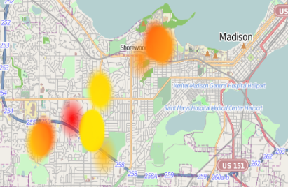

Wouldn't it be cool if, as affective scientists, we could begin to measure emotions in the real world? Every day we get a little closer to that ideal.

In the past few years, a lot more people are carrying the internet around with them. This doesn't just allow people to check email/facebook on the bus, but also opens the door to a number of cool new experiments.

For example, I can give emotional updates via post, text, or twitter. If I were bold enough, I could broadcast my location with services like [google latitude](http://www.google.com/latitude). Not only that, but there are apps that use the camera in your phone to measure heartrate and heartrate variability. More recently, I was able to play with a new toy that pushes this one step further. I got a chance to walk around with an [affectiva](http://www.affectiva.com/q-sensor/) sensor, which wirelessly measures my skin conductance for long periods of time. I wore it like a wrist-watch, while it measured my electrodermal activity (EDA; I think mostly the tonic portions) over the course of a few days.

In addition to being able to look at the timecourse relative to what was going on in my life, since I keep track of where I am using [google latitude](http://www.google.com/latitude), I thought it would be cool to see a map of my EDA levels. As a proof-of-principle, I wrote some python code to match my EDA data where google latitude's XML file said I was. Here is what I got!

I look forward to the future, when we can all take advantage of these tools. :-D

Questions? Comments? As always, feel free to contact me.
