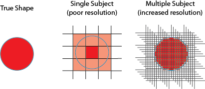

It's easy to think that as you increase the N of your imaging study, some of the details can matter less because you have enough power. I tend not to buy into this plan. In the case of intersubject registration, I think you are missing the boat if you don't make sure it's done well.

In fact, I am convinced that as you increase the number of subjects you can actually achieve sub-voxel resolution. In particular, by making the grid smaller as you go to a standard space, assuming subjects' placement and registration error are normally distributed, you should be able to, on average, get higher resolution data in standard space.

For example, If it were the same image measured multiple times with different offsets the grid would be slightly offset, and assuming a perfect registration, you would see the grid offset in an upsampled standard space, as seen below.

Therefore, although each subject will not gain by registering to an higher-resolution space, on average you can gain information if the standard space grid matches the accuracy of normalization.

Similarly, if you perform this same process on three groups, true differences at a sub-voxel level could become apparent. As you increase the number of subjects this should become increasingly true for continuous effects.

That said, the upper-limit of this benefit will be reflected in the quality of your [inter-subject registration.](/resources/looking-at-co-registered-brain-data/)

At least that is how I think about it at the moment. If you have any thoughts, or would like to discuss further, drop me a line. :-D
